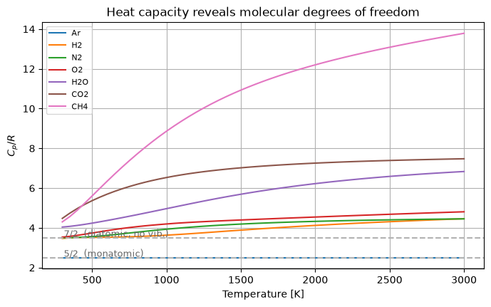
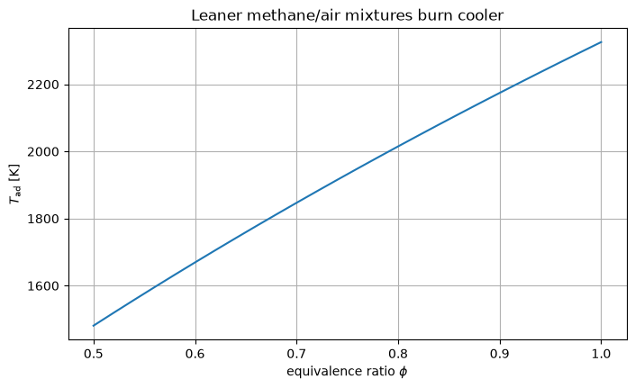
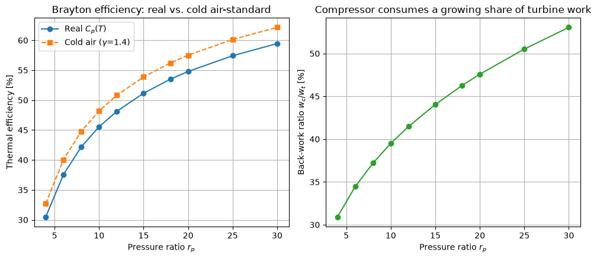
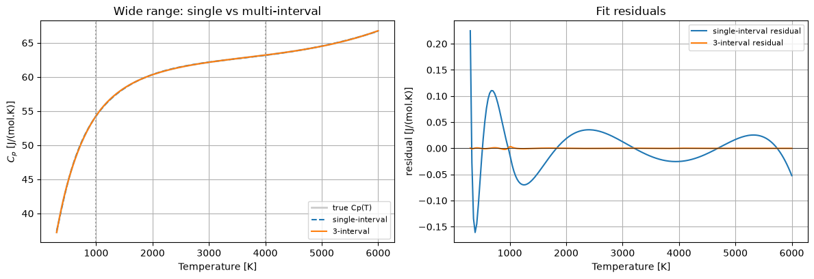
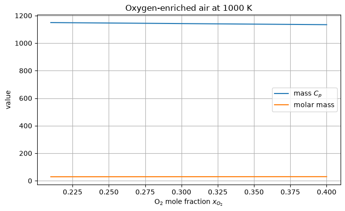

# pyglenn-notebooks

## 1. Introduction

Accurate thermochemical data are essential for modeling reactive flows, designing combustion systems, and performing equilibrium calculations in chemical engineering. The NASA (Glenn) polynomial representation is one of the most widely adopted formats in computational combustion and aerothermochemistry, employed by codes such as Cantera, Chemkin, and OpenFOAM. These polynomials encode the temperature-dependent behavior of the constant-pressure molar heat capacity $C_p^\circ(T)$, the standardized molar enthalpy $H^\circ(T)$, and the molar entropy $S^\circ(T)$ across piecewise temperature intervals for thousands of chemical species.

The `pyglenn` library [1] provides a lightweight, dependency-free Python interface to a bundled SQLite database containing NASA polynomial coefficients for approximately 2,030 species spanning 3,772 temperature intervals. Unlike larger thermochemical frameworks that require complex installation procedures and numerous dependencies, `pyglenn` is installable with a single `pip` command and requires only NumPy (>= 1.21) at runtime.

The **pyglenn-notebooks** repository complements the core library by offering twelve worked examples that progressively build the user's understanding—from basic property lookups to mixture thermochemistry, coefficient fitting, and sophisticated multi-species equilibrium and cycle analyses. This paper describes the scope, theoretical grounding, and practical outcomes of the repository.

# 2. Theoretical Background

## 2.1 NASA (Glenn) Polynomial Formulation

The NASA (Glenn) polynomial representation expresses the three fundamental molar properties as functions of temperature using a nine-coefficient scheme per temperature interval. For a given interval, the dimensionless forms are:

$$\frac{C_p^\circ}{R} = \frac{a_1}{T^2} + \frac{a_2}{T} + a_3 + a_4 T + a_5 T^2 + a_6 T^3 + a_7 T^4$$

$$\frac{H^\circ}{RT} = -\frac{a_1}{T^2} + a_2\frac{\ln T}{T} + a_3 + a_4\frac{T}{2} + a_5\frac{T^2}{3} + a_6\frac{T^3}{4} + a_7\frac{T^4}{5} + \frac{b_1}{T}$$

$$\frac{S^\circ}{R} = -\frac{a_1}{2T^2} - \frac{a_2}{T} + a_3\ln T + a_4 T + a_5\frac{T^2}{2} + a_6\frac{T^3}{3} + a_7\frac{T^4}{4} + b_2$$

where $R$ is the gas constant, the seven coefficients $a_1 \ldots a_7$ fix the shape of $C_p$, and the two integration constants $b_1$ and $b_2$ set the enthalpy and entropy references — $b_1$ is chosen so $H^\circ$ carries the enthalpy of formation, and $b_2$ so $S^\circ$ is the absolute (Third-Law) entropy.

## 2.2 Thermodynamic Relationships

The notebooks leverage fundamental thermodynamic identities throughout:

- **Reaction enthalpy** via Hess's law: $\Delta H_\text{rxn}(T) = \sum \nu_i H_i^\circ(T)$, where $\nu_i$ are stoichiometric coefficients (negative for reactants, positive for products).
- **Gibbs free energy**: $G^\circ(T) = H^\circ(T) - T S^\circ(T)$, the central quantity for chemical equilibrium.
- **Equilibrium constant**: $K(T) = \exp(-\Delta G^\circ(T) / RT)$, computed directly from `pyglenn` property outputs.
- **Adiabatic flame temperature**: solved by equating the total enthalpy of reactants (at the initial temperature) to the total enthalpy of products (at the unknown adiabatic temperature), using an iterative root-finding scheme.

## 2.3 Applications

The theoretical framework is applied across six major domains:

1. **Combustion**: computing lower and higher heating values (LHV/HHV), adiabatic flame temperatures, and equivalence-ratio sensitivity for hydrocarbons and oxygenated fuels.
2. **Biofuels**: comparative analysis of ethanol, methanol, gasoline, and jet fuel—covering energy density, air–fuel ratio, and CO$_2$ emission intensity.
3. **Power cycles**: air-standard Brayton cycle analysis using real temperature-dependent $C_p(T)$ instead of the cold-air-standard approximation, with isentropic state determination via entropy matching.
4. **Chemical kinetics support**: batch generation of property tables and cached coefficient lookups suitable as inputs to CFD solvers and ODE-based kinetic integrators.
5. **Mixture thermochemistry**: mole-fraction-weighted mixing of fixed-composition ideal-gas mixtures, reported on molar and mass bases.
6. **NASA-7 coefficient fitting**: least-squares recovery of the heat-capacity coefficients from tabulated data, including multi-interval fits with $C_p$ and $C_p'$ continuity.

# 3. Results

The repository is structured as twelve sequentially ordered notebooks, each building on concepts introduced earlier.

**Notebook 01 — Getting Started** establishes the workflow: connecting to the bundled database, searching for species by name or formula, and computing $C_p^\circ$, $H^\circ$, and $S^\circ$ at a single temperature. The `exact_match=True` parameter of `get_available_species()` is introduced for reliable exact-name lookups, along with exception-based error handling via `try/except ThermoCalcError`.

**Notebook 02 — NASA Polynomials Under the Hood** demystifies the numerical machinery by implementing the 9-term polynomial evaluation from scratch and validating the results against `pyglenn`'s built-in API. The piecewise nature of the intervals and the meaning of the integration constants $b_1$ and $b_2$ are explained with worked numerical examples.

**Notebook 03 — Temperature-Dependent Properties & Plotting** generates $C_p(T)$, $H(T)$, and $S(T)$ curves for selected species, illustrating equipartition behavior and the vibrational excitation that causes heat capacity to rise with temperature, and introduces the single-temperature helpers `gamma(T)`, `dcp_dt(T)`, and `h_sensible_to(T)`. Property tables are constructed using `pandas`.

**Notebook 04 — Enthalpy of Formation** recovers $\Delta_f H^\circ$ from the standardized `h_relative` output at 298.15 K and validates results against literature values.

**Notebook 05 — Reaction Enthalpies & Heats of Combustion** applies stoichiometric summation to compute $\Delta H_\text{rxn}(T)$ for representative combustion reactions, deriving LHV and HHV values.

**Notebook 06 — Adiabatic Flame Temperature** implements an energy-balance root-finding loop to determine $T_\text{ad}$ for methane–air combustion, exploring the effects of equivalence ratio and reactant preheat.

**Notebook 07 — Comparing Fuels & Biofuels** provides a systematic side-by-side comparison of conventional and renewable fuels on multiple performance metrics, directly supporting sustainability-oriented engineering decisions.

**Notebook 08 — Chemical Equilibrium & Gibbs Free Energy** computes $G^\circ(T)$ for all species, evaluates equilibrium constants $K(T)$ for the water-gas shift reaction, and demonstrates the van't Hoff equation for temperature extrapolation.

**Notebook 09 — Brayton Gas-Turbine Cycle** models the air-standard Brayton cycle with real $C_p(T)$ data, determines isentropic states by matching entropy across compressor and turbine stages, and compares the real-gas efficiency (45.6%) against the cold air-standard formula (48.2%), which assumes a constant $\gamma = 1.4$.

**Notebook 10 — Property Provider for CFD & Chemical Kinetics** demonstrates batch-mode operation for generating large property tables, implements a cached coefficient provider for performance benchmarking, and showcases a simple ODE integration using temperature-dependent thermodynamic input.

**Notebook 11 — Mixtures & Mole-Fraction Weighted Properties** introduces the `Mixture` and `MixedProperties` dataclasses and `mixture_properties()`, composing mole-fraction-weighted molar and mass-basis properties for a fixed composition, with `CompositionError` validation and an oxygen-enrichment simulation.

**Notebook 12 — Fitting NASA-7 Coefficients** demonstrates `fit_nasa7` and `fit_nasa7_multi`: least-squares recovery of the seven $C_p$ coefficients from tabulated data, with $b_1$/$b_2$ anchoring and multi-interval continuity constraints.

All notebooks are pre-executed and committed with visible outputs. The documentation is built with Sphinx and the Read the Docs theme, hosted via GitHub Pages, and regenerated automatically on every push to the main branch through a GitHub Actions continuous-deployment pipeline.

### Illustrative figures

**Figure 1** — The dimensionless $C_p/R$ is flat at $5/2$ for monatomic Ar and $7/2$ for diatomics at moderate temperature, then climbs as vibrational modes activate (Notebook 03).

**Figure 2** — Methane/air $T_\mathrm{ad}$ falls from 2326 K at stoichiometry ($\phi = 1$) to 1481 K at $\phi = 0.5$ as excess air absorbs heat (Notebook 06).

**Figure 3** — The real-$C_p(T)$ Brayton efficiency (45.6%) lies below the cold air-standard value (48.2%) because $\gamma(T)$ decreases as temperature rises (Notebook 09).

**Figure 4** — Over 300–6000 K a single 7-term polynomial leaves residuals up to 0.225 J/(mol·K), while a 3-interval `fit_nasa7_multi` fit reduces the maximum error to 0.003 J/(mol·K), a ~70× improvement (Notebook 12).

**Figure 5** — Raising the O₂ mole fraction from 21% to 40% increases the mean molar mass (28.85 → 29.61 g/mol) while the mass-basis $C_p$ falls (1149 → 1134 J/(kg·K)) (Notebook 11).

# 4. Conclusion

The **pyglenn-notebooks** repository successfully bridges the gap between a lightweight thermochemical library and practical engineering education. By providing twelve fully worked, self-contained Jupyter notebooks, it enables students, researchers, and practicing engineers to:

- Quickly retrieve and interpret standard-state thermodynamic properties for over 2,000 chemical species;
- Understand the mathematical foundation of the NASA polynomial representation and its integration constants;
- Apply thermodynamic principles to real-world problems in combustion, biofuel assessment, gas-turbine cycles, and chemical equilibrium;
- Compose fixed-composition mixture properties on molar and mass bases, and recover NASA-7 coefficients from custom tabulated data;
- Generate property data suitable for integration with CFD solvers and chemical kinetics codes.

The repository's open-source nature, automated documentation deployment, and progressive pedagogical design make it a valuable contribution to the thermal-sciences community. Future work may extend the collection to include rocket propulsion thermochemistry, detonation calculations, and direct integration with the Cantera library for coupled transport-property analysis.

---

## References

[1] R. G. Leão Jr., *pyglenn: A lightweight thermochemical properties calculator from NASA polynomials*. GitHub repository. Available at: [https://github.com/ProfLeao/pyglenn](https://github.com/ProfLeao/pyglenn).

[2] B. J. McBride, M. J. Zehe, and S. Gordon, *NASA Glenn Coefficients for Calculating Thermodynamic Properties of Individual Species*, NASA/TP—2002-211556, 2002.

[3] S. R. Turns, *An Introduction to Combustion: Concepts and Applications*, 3rd ed., McGraw-Hill, 2011.
